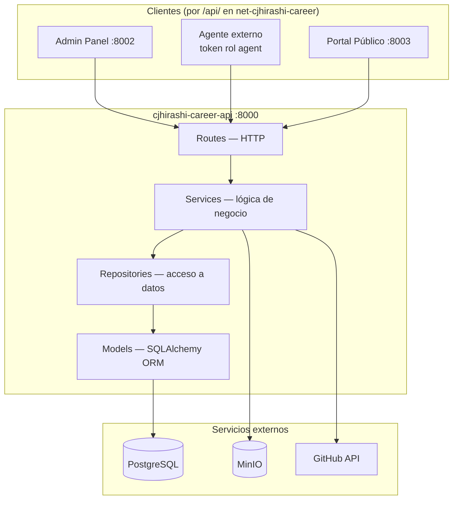
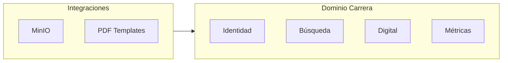
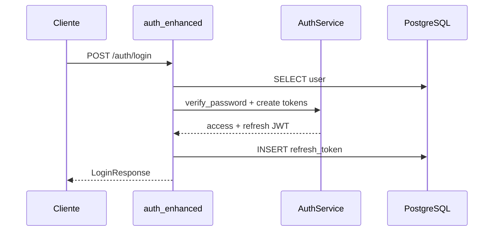
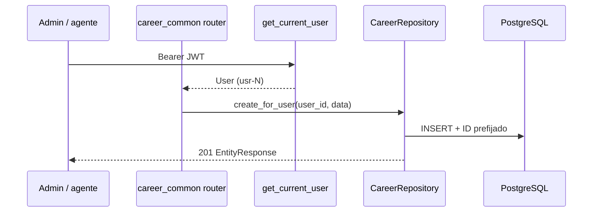

# API REST — Guía de arquitectura

**Ubicación:** `cjhirashi-career-api/docs/ARCHITECTURE.md`

**Última actualización:** 2026-11-10

Arquitectura en capas de la API REST de cjhirashi-career: FastAPI + SQLAlchemy 2.0 async + PostgreSQL, con integraciones MinIO y GitHub.

---

## Tabla de contenidos

- [Visión general](#visión-general)
- [Arquitectura en capas](#arquitectura-en-capas)
- [Consumidores y red](#consumidores-y-red)
- [Componentes principales](#componentes-principales)
- [Dominios funcionales](#dominios-funcionales)
- [Flujos de datos](#flujos-de-datos)
- [Servicios externos](#servicios-externos)
- [Principios de diseño](#principios-de-diseño)
- [Manejo de errores](#manejo-de-errores)
- [Testing](#testing)
- [Escalabilidad](#escalabilidad)
- [Documentación relacionada](#documentación-relacionada)

---

## Visión general

La API es el **único escritor** de PostgreSQL en el ecosistema. Centraliza:

- Autenticación JWT (access + refresh)
- CRUD de ≈48 recursos de carrera profesional bajo `/career`
- Archivos (MinIO), plantillas PDF
- Endpoints públicos read-only para el Portal

**Stack:** FastAPI 0.104 · SQLAlchemy 2.0 async · asyncpg · Pydantic v2 · Alembic

**Estado:** en producción — 18 routers registrados en `src/app.py`, 372 operaciones HTTP, 58 tablas y 56 migraciones Alembic. Los agentes de IA son externos (ADR-032); el subsistema Bedrock y Qdrant se retiraron el 2026-11-11 (ADR-033) y el descubrimiento de vacantes el 2026-11-12 (ADR-034).

---

## Arquitectura en capas



| Capa | Responsabilidad | Ejemplos |
|------|-----------------|----------|
| **Routes** | HTTP, validación Pydantic, auth deps | `routes/career_identity.py` |
| **Services** | Reglas de negocio, integraciones externas | `pdf_service.py` |
| **Repositories** | Queries SQLAlchemy, aislamiento por user | `career_repository.py`, `user_repository.py` |
| **Models** | Esquema ORM, relaciones | `models/vacancy.py`, `models/bedrock_task.py` |

---

## Consumidores y red

```
Admin (8002) / Portal (8003)
   └─ /api/ (la API recibe la ruta sin el prefijo) → cjhirashi-career-api:8000 (solo red interna Docker)
```

| Cliente | Auth | Endpoints típicos |
|---------|------|-------------------|
| Admin Panel | JWT | `/auth`, `/career/*`, `/agent-tasks`, `/files`, `/pdf-*`, `/notifications`, `/settings`, `/admin` |
| Portal Público | Ninguna | `/public/*`, `/events/*` |
| Agente externo | JWT de rol `agent` | `/career/*`, `POST /files` (el resto, 403) |

---

## Componentes principales

### `src/app.py`

- Lifespan: `init_db()`, MinIO bucket y scheduler de tareas de agentes
- CORS, exception handlers globales
- Registra 21 routers (ver [API.md](./API.md))
- Health check `/health`

### `src/config.py`

`pydantic_settings.BaseSettings` — JWT, PostgreSQL, MinIO, CORS y portal público.

### `src/database.py`

Engine async, `AsyncSessionLocal`, `get_db()` dependency, `init_db()` / `close_db()`.

### `src/routes/`

| Archivo | Dominio |
|---------|---------|
| `auth_enhanced.py` | Autenticación JWT + refresh |
| `career_common.py` | Factory CRUD + `RESOURCE_REGISTRY` |
| `career_identity.py` | Recursos de identidad |
| `career_search.py` | Recursos de búsqueda (vacantes, aplicaciones, CVs y cartas) |
| `career_digital.py` | Recursos de presencia digital |
| `career_support.py` | Tags |
| `career_metrics.py` | Métricas agregadas de búsqueda |
| `career_methodologies.py` | Metodologías operativas |
| `bedrock_tasks.py` | Tablero de tareas (`/agent-tasks`) |
| `notifications.py` | Notificaciones in-app |
| `admin_contact_messages.py` | Mensajes del formulario de contacto |
| `pdf_templates.py` | Plantillas HTML (`pdf_template`) |
| `pdf_template_styles.py` | Estilos CSS (`pdf_style`) |
| `files.py` | Upload MinIO |
| `public.py` | Portal read-only y contacto |
| `error_reports.py` | Registro de errores |
| `events.py` | Ingesta y borrado de analítica |
| `portal_metrics.py`, `portal_analytics.py` | Consulta y configuración de la analítica |

Documentación por sección: [sections/README.md](./sections/README.md)

### `src/services/`

| Paquete / módulo | Rol |
|------------------|-----|
| `auth_service.py` | Hash bcrypt, JWT access/refresh |
| `portal_*.py` | Analítica: ingesta, sesionización, bots, geografía, canales, dispositivo, límites de tasa y métricas |
| `contact_message_service.py` | Mensajes del formulario de contacto |
| `error_report_service.py`, `error_reporting.py` | Registro y deduplicación de errores |
| `storage_service.py` | MinIO upload/presigned URLs |
| `pdf_service.py` | Generación PDF |
| `id_generator.py` | IDs prefijados (`ach-17`, `usr-1`) |

### `src/repositories/`

- `career_repository.py` — CRUD genérico con aislamiento `user_id`
- `user_repository.py` — queries de usuario

### `src/middleware/auth.py`

`get_current_user` — decodifica JWT, extrae `sub` (ID prefijado `usr-N`), carga `User`.

### `src/schemas/`

Pydantic v2 por dominio: `user`, `career_identity`, `career_search`, `career_digital`, `public`, etc.

### `src/models/`

69 modelos ORM. Import centralizado en `models/__init__.py`. Ver [DATABASE.md](./DATABASE.md).

---

## Dominios funcionales



---

## Flujos de datos

### Login con refresh token



### CRUD de carrera (factory)



---

## Servicios externos

| Servicio | Uso en API | Config |
|----------|------------|--------|
| PostgreSQL | Persistencia única | `DATABASE_URL` |
| MinIO | Archivos | `MINIO_*` |
| GitHub API | Repos públicos | Sin key (API pública) |

---

## Principios de diseño

**Single Responsibility:** cada router/service por dominio; `CareerRepository` solo acceso a datos de carrera.

**Open/Closed:** `build_crud_router()` extiende CRUD sin modificar el factory.

**Dependency Inversion:** routes dependen de `Depends(get_db)`, `Depends(get_current_user)`, servicios inyectables.

**DRY:** un repositorio y un registry (`RESOURCE_REGISTRY`) para ≈48 recursos; los agentes externos usan el mismo CRUD que el Admin.

**Aislamiento multi-tenant:** `user_id` siempre del JWT, nunca del request body.

---

## Manejo de errores

| Nivel | Comportamiento |
|-------|----------------|
| Route | `HTTPException` (401, 404, 422, 502, 503) |
| Service | `ValueError` → convertido en route |
| App global | `RequestValidationError` → 422 `{"detail": "Error de validación", ...}` con la lista de errores |
| App global | `Exception` no capturada → 500 + log y registro en `error_reports` |
| App global | Los 5xx y los 4xx relevantes (salvo 401 y 404) se registran en `error_reports` con huella |


---

## Testing

Estructura en `cjhirashi-career-api/tests/`:

| Carpeta | Alcance |
|---------|---------|
| `unit/` | Services, middleware |
| `integration/` | Auth routes, flujos HTTP |
| `conftest.py` | Fixtures async, DB test |

Ver [TESTING.md](./TESTING.md).

---

## Escalabilidad

**Implementado:**
- App stateless (JWT, sin sesión en memoria)
- Async end-to-end
- Connection pool (`pool_size=10`, `max_overflow=20`)
- Paginación en listados CRUD

**Limitación:** el scheduler de tareas corre in-process con un solo worker; con varias réplicas duplicaría ejecuciones (se resuelve al mover el harness, ADR-029).

**No implementado:**
- Cache Redis
- Cola de mensajes (Celery/RQ)
- Réplicas read PostgreSQL
- Versionado API (`/v1`)

---

## Documentación relacionada

| Documento | Ubicación | Contenido |
|-----------|-----------|-----------|
| README API | [../README.md](../README.md) | Overview y mapa de secciones |
| Secciones | [sections/README.md](./sections/README.md) | README detallado por dominio |
| Endpoints | [API.md](./API.md) | Referencia rápida |
| Base de datos | [DATABASE.md](./DATABASE.md) | Esquema PostgreSQL |
| Seguridad | [SECURITY.md](./SECURITY.md) | JWT, CORS, OWASP |
| Setup | [SETUP.md](./SETUP.md) | Instalación y Docker |

---

**Relacionado:** [DATABASE.md](./DATABASE.md) · [SECURITY.md](./SECURITY.md) · [API.md](./API.md)
