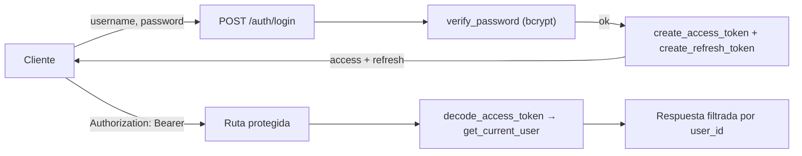

# API REST — cjhirashi-career — Modelo de seguridad

**SECURITY** · **Última actualización**: 2026-11-05

Implementación de seguridad de la API: autenticación JWT, hashing de contraseñas, rol `agent`, aislamiento de datos por usuario, validación de entrada y límites de tasa. Visión transversal: [../../docs/08-CROSSCUTTING-CONCEPTS.md](../../docs/08-CROSSCUTTING-CONCEPTS.md); variables y secretos: [../../docs/ENVIRONMENT-SECURITY.md](../../docs/ENVIRONMENT-SECURITY.md).

## Autenticación JWT

- **Algoritmo**: HS256 con `SECRET_KEY` (obligatoria, 32+ caracteres).
- **Tokens** (`services/auth_service.py`): de **acceso** (`ACCESS_TOKEN_EXPIRE_DAYS`, 7 días por defecto) y de **refresco** (`REFRESH_TOKEN_EXPIRE_DAYS`, 30), con `type` en el payload. El `sub` es el ID prefijado del usuario (`usr-N`).
- **Refresco**: `POST /auth/refresh` valida el token de refresco por firma, tipo y expiración, y comprueba que el usuario siga activo. `POST /auth/logout` solo registra la salida: el cliente descarta los tokens. La tabla `refresh_tokens` (con `token_hash`, `is_revoked`) existe en el modelo, pero las rutas de refresco y salida **no la usan**: no hay revocación del lado del servidor, ni de acceso ni de refresco; caducan solos.
- **Validación**: `middleware/auth.py` (`get_current_user`) decodifica el token, carga el `User` y lo inyecta en cada ruta protegida.

## Contraseñas

`bcrypt` (12 rondas) directamente, sin passlib. Longitud mínima de 8 caracteres en el registro y en el cambio de contraseña (`POST /auth/change-password`, la nueva debe diferir de la actual). Nunca se guarda ni se registra la contraseña en claro.

## Rol `agent`

Las cuentas con `access_role = agent` son para agentes externos. `middleware/auth.py` solo les permite `/career/*`, `POST /bedrock/chat` y `POST /files` (subida); cualquier otra ruta responde **403** «Agent token is not authorized for this endpoint». No pueden listar, cambiar la visibilidad, descargar ni borrar archivos, para que un token de agente no enumere ni retire los archivos reales de Carlos. Las rutas `/public` no pasan por esta dependencia.

## Aislamiento por usuario

Todo endpoint de carrera filtra por el `user_id` del **token**, nunca del cuerpo de la petición (`CareerRepository`). Un recurso de otro usuario responde `404`, no `403`, para no revelar su existencia. El portal público lee con el usuario dueño del portafolio (`PUBLIC_PORTAL_USER_ID`).

## Validación de entrada

Pydantic v2 valida tipo, longitud y formato; los errores de validación responden `422` con `{"detail": "Error de validación", ...}` y la lista de errores. Los `5xx` y los `4xx` relevantes (salvo 401 y 404) se registran en `error_reports`.

## SQL injection

Todo el acceso a datos pasa por SQLAlchemy ORM con consultas parametrizadas; no hay SQL crudo interpolado con datos de usuario.

## Límites de tasa y abuso

- Formulario de contacto (`POST /public/contact-message`): 3 mensajes por hora por IP y por correo, y un campo señuelo (*honeypot*).
- Analítica (`POST /events/track`): límite por ventana deslizante, clasificación de bots (umbral 70) y respeto a DNT/GPC en el cliente.
- El resto de rutas no tiene límite de tasa propio en la API.

## CORS

Los orígenes salen de `CORS_ORIGINS` (lista separada por comas en `config.py`). La plantilla trae `http://localhost:8002` (Admin) y `http://localhost:8003` (Portal); en producción pon los orígenes reales.

## Secretos

Solo en `.env` (nunca versionado); `docker-compose.yml` usa `${VARIABLE}`. Detalle en [ENVIRONMENT-SECURITY](../../docs/ENVIRONMENT-SECURITY.md).

## Deuda técnica de seguridad

| # | Deuda | Detalle |
|---|---|---|
| 1 | **Registro público abierto** | `POST /auth/register` no requiere autenticación ni tiene guarda: está accesible desde Internet (comprobado el 2026-11-05: responde 422 de validación desde fuera de la red Docker). Cualquiera puede crear una cuenta `user` con acceso al CRUD de su propio espacio, a la subida de archivos y al chat de Bedrock (consumo propio de la cuenta). El sistema está pensado para un solo administrador; decidir si se desactiva, se protege con un código de invitación o se limita al rol `service`. |
| 2 | Tokens sin revocación del lado del servidor | Los de acceso (7 días) y los de refresco (30) valen hasta caducar; `logout` no los invalida. Valorar una vida menor y usar `refresh_tokens` para revocar. |
| 3 | `SECRET_KEY` única (HS256) | Sin rotación programada. |
| 4 | Sin Row-Level Security | El aislamiento es solo de aplicación. |
| 5 | Sin escaneo automático de dependencias | El CI solo corre pruebas. |
| 6 | Credenciales de AWS en variables de entorno | Rotación y alcance del rol IAM pendientes ([BEDROCK-HARNESS.md](./BEDROCK-HARNESS.md)). |

## Checklist de producción

- [ ] `SECRET_KEY` aleatoria de 32+ caracteres y distinta por entorno
- [ ] `DEBUG=false`
- [ ] `CORS_ORIGINS` con los orígenes reales
- [ ] `.env` fuera de git; contraseñas propias de PostgreSQL y MinIO
- [ ] API sin puerto publicado al host
- [ ] Credenciales de AWS con permisos mínimos y `BEDROCK_DAILY_BUDGET_USD` definido
- [ ] Decisión tomada sobre el registro público (deuda 1)
