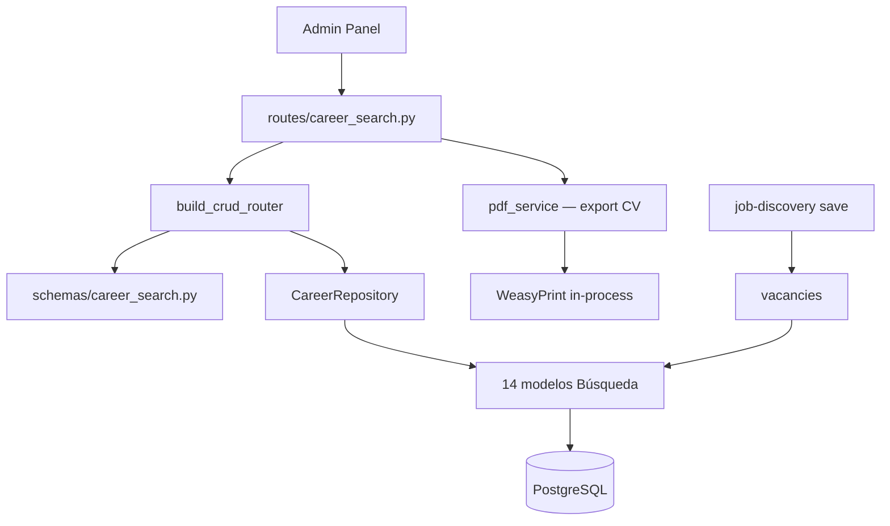

# Carrera — Búsqueda de Empleo

Recursos del dominio **Búsqueda**: estrategia, vacantes, aplicaciones, entrevistas, CVs y cartas de presentación.

**Prefijo:** `/career`  
**Tag OpenAPI:** `Career - Search`  
**Auth:** JWT requerido

## Arquitectura



---

## Archivos fuente

| Capa | Archivo |
|------|---------|
| Rutas | `src/routes/career_search.py` |
| Schemas | `src/schemas/career_search.py` |
| PDF | `src/services/pdf_service.py`, `pdf_template_render.py` |

---

## Recursos CRUD (14)

| Resource key | Path | Modelo | Notas |
|--------------|------|--------|-------|
| `fit-scoring-factors` | `/career/fit-scoring-factors` | `FitScoringFactor` | Rúbrica de encaje |
| `market-segments` | `/career/market-segments` | `MarketSegment` | Segmentos de mercado |
| `role-narratives` | `/career/role-narratives` | `RoleNarrative` | Narrativas por rol |
| `search-plans` | `/career/search-plans` | `SearchPlan` | Planes de búsqueda activos |
| `networking-contacts` | `/career/networking-contacts` | `NetworkingContact` | Contactos de networking |
| `target-companies` | `/career/target-companies` | `TargetCompany` | Empresas objetivo |
| `vacancies` | `/career/vacancies` | `Vacancy` | Vacantes en seguimiento; etapa y estado: ver [Etapa y estado de la vacante](#etapa-y-estado-de-la-vacante) |
| `cv-versions` | `/career/cv-versions` | `CVVersion` | **`vectorize=False`** |
| `cover-letter-versions` | `/career/cover-letter-versions` | `CoverLetterVersion` | Cartas por vacante/rol |
| `applications` | `/career/applications` | `Application` | Postulaciones |
| `application-interactions` | `/career/application-interactions` | `ApplicationInteraction` | Seguimiento por aplicación |
| `interviews` | `/career/interviews` | `Interview` | Entrevistas |
| `contact-interactions` | `/career/contact-interactions` | `ContactInteraction` | Interacciones con contactos |
| `networking-activities` | `/career/networking-activities` | `NetworkingActivity` | Actividades de red |

Patrón CRUD: ver [infrastructure](../infrastructure/README.md).

---

## Esquema: `applications` / `application-interactions` / `interviews` (checklist Paulina #13)

Las tres tablas están vacías en producción (0 registros) — no se pudieron inspeccionar con datos
reales vía API. Esquema confirmado leyendo directamente los modelos
(`src/models/application.py`, `application_interaction.py`, `interview.py`).

**`applications`** (`Application`, prefijo id `apl-`)

| Campo | Tipo | Notas |
|-------|------|-------|
| `vacancy_id` | FK → `vacancies.id`, `CASCADE` | **Requerido.** FK ya existe y es correcta. |
| `cv_version_id` | FK → `cv_versions.id`, `SET NULL` | Opcional |
| `cover_letter_version_id` | FK → `cover_letter_versions.id`, `SET NULL` | Opcional |
| `recruiter_contact_id` | FK → `networking_contacts.id`, `SET NULL` | Opcional |
| `applied_at` | datetime | — |
| `current_status` | string, check | `applied \| in_process \| offer \| rejected \| archived` |
| `final_result` | string, check | `offer_accepted \| offer_rejected \| rejected \| negotiating` |
| `notes` | text | — |

**`application-interactions`** (`ApplicationInteraction`, prefijo id `ain-`)

| Campo | Tipo | Notas |
|-------|------|-------|
| `application_id` | FK → `applications.id`, `CASCADE` | **Requerido.** FK ya existe y es correcta. |
| `interaction_at` | datetime | — |
| `channel` | string(50) | Libre (email, llamada, mensaje…) |
| `content_sent` | text | — |
| `response_received` | text | — |
| `status` | string(50) | Libre |
| `notes` | text | — |

**`interviews`** (`Interview`, prefijo id `ivw-`)

| Campo | Tipo | Notas |
|-------|------|-------|
| `application_id` | FK → `applications.id`, `CASCADE` | **Requerido.** FK ya existe y es correcta. |
| `narrative_used_id` | FK → `role_narratives.id`, `SET NULL` | Opcional |
| `interview_type` | string(50) | Libre |
| `scheduled_at` | datetime | — |
| `interviewers`, `questions_asked`, `answers_given`, `feedback_received` | text | — |
| `overall_impression` | string, check | `very_positive \| positive \| neutral \| negative` |
| `interview_result` | string, check | `pending \| advanced \| rejected \| under_consideration` |
| `notes` | text | — |

No se proponen cambios de esquema para estas tres tablas — el checklist solo pedía documentarlas y
confirmar sus relaciones.

---

## Etapa y estado de la vacante

Spec 007. La columna `process_stage` de `vacancies` (reemplaza a `application_status`) guarda la **etapa** del proceso; el **estado** (`vacancy_status`) se calcula a partir de ella y nunca se guarda.

| Etapa (`process_stage`) | Estado (`vacancy_status`) |
|---|---|
| `not_applied` | `pending` (Por postular) |
| `applied`, `screening`, `hr_interview`, `technical_interview`, `technical_test`, `final_interview`, `offer`, `hiring_process` | `in_process` (En proceso) |
| `hired`, `rejected`, `withdrawn`, `no_response` | `closed` (Cerrada) |

- **Catálogo y mapeo:** `src/services/vacancy_stage.py` (`PROCESS_STAGES`, `STAGE_TO_STATUS`). El CHECK `ck_vacancies_process_stage`, los schemas y el repositorio salen de ahí. El canon de los tests es `contracts/process-stage-catalog.json` de la spec 007.
- **Valor por defecto:** una vacante sin etapa queda `not_applied` (también las que guarda el job discovery). La columna es NOT NULL.
- **Campos de solo lectura:** `vacancy_status` y `process_stage_updated_at` se devuelven en las respuestas, pero se descartan si llegan en un POST/PUT (REST y tools de Bedrock).
- **Fecha de la etapa:** `process_stage_updated_at` se fija al crear la vacante y cada vez que la etapa cambia a un valor distinto. Un update que omite la etapa o reenvía la misma no la mueve. Se puede saltar o retroceder etapas: no se valida la transición.
- **Filtro por estado:** `filters={"vacancy_status": ["pending", ...]}` en `GET /career/vacancies` y `/count` se expande a las etapas del mapeo; se combina (AND) con un filtro `process_stage`. Un estado inválido no devuelve filas.
- **Errores:** una etapa fuera de catálogo, o `process_stage: null` en un PUT, responde 422 con el formato de validación vigente del API (`{"detail": "Error de validación", "errors": [...]}`), no Problem Details RFC 9457 (D-14; deuda preexistente de todo el API). Desde las tools de Bedrock el error llega como `ValueError`.
- **Base de conocimiento (D-13):** `process_stage` se indexa; `process_stage_updated_at` no entra al texto indexado.
- **Migración:** `c7e1a4d92b60` (renombra `application_status`, NULL a `not_applied`, rellena la fecha, añade el CHECK). Falla antes de tocar nada si hay valores fuera del catálogo.

---

## Textos descriptivos de la vacante

Spec 008. `vacancies` guarda cuatro textos largos opcionales sobre la empresa y el puesto (`TEXT NULL`, sin default; las vacantes existentes quedan en `NULL`).

| Columna | Qué guarda |
|---|---|
| `company_overview` | Quiénes son |
| `candidate_profile` | Qué buscan |
| `offer_summary` | Qué ofrecen |
| `work_culture` | Cultura laboral |

- **Reglas (REST, schemas `VacancyBase`/`VacancyUpdate`):** se recortan los espacios de los bordes (el contenido interno se conserva); vacío o solo espacios pasa a `NULL`; el tope es 10 000 caracteres medidos tras el recorte. Superarlo responde 422 con `{"detail", "errors"}` y no cambia la fila. `null` explícito en un PUT borra el campo; omitirlo lo deja intacto. Las respuestas siempre incluyen las cuatro claves (valor o `null`).
- **Tools de Bedrock (D-07):** `create/update_career_record` no pasan por Pydantic, así que **no** aplican el recorte, el vacío a `NULL` ni el tope. La spec 009 mueve esa escritura a REST.
- **Base de conocimiento (RF-006, transitorio):** los cuatro campos están en `_KB_EXCLUDED_COLUMNS["vacancies"]` y no se indexan. Es temporal: se retira con la spec 009, que decide su indexado.
- **Migración:** `d8f2b5a13c97` (idempotente; el downgrade elimina las columnas y su contenido).

---

## Endpoint custom: PDF de CV

| Método | Path | Descripción |
|--------|------|-------------|
| `POST` | `/career/cv-versions/{cv_version_id}/pdf` | Renderiza CV Markdown → PDF descargable |

**Query params:**
- `template_id` (opcional) — ID de plantilla `pdt-N` en `/pdf-templates`

**Flujo:**
1. Carga `CVVersion` del usuario
2. Si hay `template_id`, usa HTML template + `render_template_html`
3. Si no, genera PDF desde Markdown con `generate_markdown_document`
4. Retorna `StreamingResponse` (`application/pdf`)

---

## Agente Bedrock

Perfil L2 **`agent_search_operations`** — pipeline de vacantes, aplicaciones y entrevistas. Discovery: L3 **`agent_vacancy_search`**. Redacción: L3 **`agent_cv_writing`** (`cv-versions`) y **`agent_cover_letter_writing`** (`cover-letter-versions`). PDF: L3 **`agent_pdf_render`**.

Tools de job discovery (también expuestas vía `/career/job-discoveries`):

- `list_job_providers`, `run_job_discovery`, `import_job_url`, `save_job_listings`

Reglas del agente:
- `run_job_discovery` solo hace **preview** (refs L1, L2…)
- `save_job_listings` requiere autorización explícita del usuario
- No inventar vacantes ni usar `create_career_record` para ofertas descubiertas

Ver [job-discovery](../job-discovery/README.md).

---

## Métricas

Los datos de vacantes, aplicaciones e entrevistas alimentan:

- `GET /career/metrics/weekly`
- `GET /career/metrics/search-overview`

Ver [career-metrics](../career-metrics/README.md).

---

## Ejemplo: listar vacantes pendientes

```bash
curl -s "http://localhost:8001/career/vacancies?search=pending&limit=50" \
  -H "Authorization: Bearer $TOKEN"
```

## Ejemplo: generar PDF de CV

```bash
curl -s -X POST "http://localhost:8001/career/cv-versions/cvv-3/pdf?template_id=pdt-1" \
  -H "Authorization: Bearer $TOKEN" \
  -o cv.pdf
```

---

Ver también: [job-discovery](../job-discovery/README.md), [pdf-templates](../pdf-templates/README.md)
