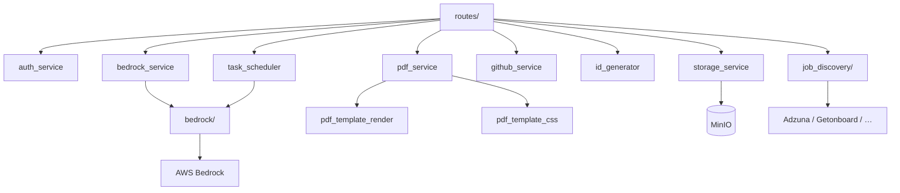

# Paquete `services/`

Lógica de negocio e integraciones externas. Las rutas no hablan con AWS, ni MinIO directamente: pasan por estos módulos.

## Arquitectura

---

## Subpaquetes

| Paquete | README |
|---------|--------|
| `bedrock/` | [bedrock/README.md](bedrock/README.md) — harness Converse: guía en 3 niveles (paquete → módulo → función) con recibe/entrega, ejemplo y diagrama |
| `job_discovery/` | [job_discovery/README.md](job_discovery/README.md) — adaptadores de vacantes y preview-then-save |

---

## Módulos

### Analítica del portafolio (SPEC-0010)

| Módulo | Función |
|--------|---------|
| `portal_ingest.py` | `ingest_event`: sitio, visitante (bloqueo consultivo), visita con corte de 30 min, canal, postulación, bots, dueño, contadores y eventos clave. No hace commit |
| `portal_channels.py` | `classify_channel` con reglas de `portal_channel_rules`; `extract_domain` |
| `portal_bots.py` | `score_bot` aditivo y explicable (umbral 70) |
| `portal_device.py` | `parse_device` con `ua-parser`: navegador, sistema, tipo de dispositivo, idioma |
| `portal_geo.py` | Geografía solo desde las cabeceras `cf-*` que añade la capa de entrada (sin respaldo por IP ni servicio externo) |
| `portal_ratelimit.py` | Ventana deslizante en memoria por visitante e IP |
| `portal_metrics.py` | `MetricsQuery` y todas las métricas; `rebuild_daily`, `ensure_daily_fresh`, `rebuild_visits` |

### `auth_service.py` — JWT y contraseñas

`AuthService` (SRP: solo autenticación).

| Método | Función |
|--------|---------|
| `hash_password` / `verify_password` | bcrypt, tope 72 bytes |
| `create_access_token` / `create_refresh_token` | JWT HS256 con expiración de `settings` |
| `decode_access_token` / `decode_refresh_token` | Valida tipo de token y firma |
| `extract_user_id_from_token` | `sub` del payload |

Usado por `middleware.auth` y `routes.auth_enhanced`.

### `bedrock_service.py` — Fachada del agente

El loop de chat vive en `services/bedrock/` ([guía por módulo](bedrock/README.md)). Este módulo conserva:

- Tools CRUD de carrera (`_execute_tool` + `RESOURCE_REGISTRY`).
- Bitácora / restore de deletes.
- Conversaciones PG usadas por el harness.

`BedrockError` se traduce a HTTP 502/503 en las rutas.

### `id_generator.py` — IDs prefijados

Formato `{prefijo}-{n}` (`ach-17`, `vac-5`, `usr-1`). `TABLE_PREFIXES` es la fuente de verdad tabla → prefijo.

| Función | Uso |
|---------|-----|
| `register_id_listener(Model, prefix)` | Sequence PostgreSQL + listener `before_insert` |
| `normalize_prefixed_id` | Acepta `17` o `ach-17` y devuelve el ID canónico |
| `prefix_for_key` | Prefijo por `resource_key` |

Cada modelo de carrera llama `register_id_listener` al importarse.

### `storage_service.py` — MinIO

I/O de bucket S3-compatible. Sin acceso a BD.

`ensure_bucket`, `upload_file`, `set_visibility` (mueve entre `public/` y `private/`), `delete_file`, `get_public_url`, `get_presigned_url`, `get_object_stream`. Tráfico interno sin TLS.

### `pdf_service.py` — Generación PDF (WeasyPrint in-process)

`generate_markdown_document` y `generate_html_template_pdf` → bytes PDF. WeasyPrint corre en un `ProcessPoolExecutor` (fork en Linux) para que un crash nativo no tumbe uvicorn. Timeout 60 s. `PDFGeneratorError` si falla el render.

### `pdf_template_render.py`

Sustitución `{{variable}}` en HTML de plantillas antes de WeasyPrint.

### `pdf_template_css.py`

`resolve_template_css`: lee `PdfTemplateStyle` por `style_id` de la plantilla (activo).

### `methodology_scope.py`

`applies_to_agent(agent_profile_ids, caller_id)`: lista vacía = todos; `agent_methodologies` ve todas. Usado al armar el catálogo del system prompt.

`list_assigned_methodologies(db, user_id, caller_id)`: títulos vigentes asignados al agente (Admin → Agentes). Se inyecta cada turno en `compose_system_prompt` para que una metodología nueva asignada se asuma sin cambiar código.

`set_agent_methodologies(db, user_id, profile_id, ids)`: asigna desde el catálogo de agentes (Admin). Vacío = compartida; al quitar el último dueño se aparca en `agent_methodologies`.

**spec 004 (ADR-027) — L2 por sección:** `applies_to_caller(agent_profile_ids, section_ids, caller_id, caller_section_ids)` reemplaza a `applies_to_agent`: un **L2** ve una metodología si alguna de sus secciones está en `section_ids`; un **L1/L3** si su id está en `agent_profile_ids`; compartida si ambos vacíos. `applies_to_agent` queda como shim. `strip_l2_from_agent_ids` lo usa la migración `b3d4e5f6a7c8`.

### `section_catalog.py` (spec 004)

`derived_tools_for_agent(db, profile_id)`: unión de `admin_sections.tools_for_section` sobre `sections_for_agent` — el set de herramientas de un L2 (derivado, no editable). `section_methodology_ids` / `set_section_methodologies(db, user_id, section_id, ids)`: liga/desliga metodologías a una sección (`operational_methodologies.section_ids`) + reindex best-effort. `update_section(..., views=...)` ya persistía los textos de sidebar por vista; la tool `admin_section_settings` los expone desde spec 004.

### `github_service.py`

Lista repos públicos de un username (`GET api.github.com/users/{u}/repos`) para el Admin. Con `GITHUB_TOKEN`, el L3 `agent_github` lee repos (incl. privados), archivos y `search/code`. `GitHubError` en 404, 401 o rate limit. No escribe (issues/PRs/push).

### `web_search_service.py`

Consulta web del L3 `agent_web_search`: `search` (Brave si hay `BRAVE_SEARCH_API_KEY`, si no DuckDuckGo HTML) y `fetch` de URLs públicas con bloqueo SSRF. No toca PostgreSQL.

### `task_scheduler.py`

Task asyncio en el mismo lifespan. Cada 30 s reclama `bedrock_tasks` con `assignee_type=agent`, `status=pending` y `scheduled_at <= now`, e invoca `run_single_turn_sync` (ADR-015). `POST /agent-tasks/{id}/run` usa el mismo runner.

### `__init__.py`

Vacío. Los consumidores importan módulos concretos (`from services import storage_service`).

---

## Servicios añadidos (operación, contacto y vacantes)

| Módulo | Rol |
|---|---|
| `contact_message_service.py` | Lógica de los mensajes de contacto del portafolio: valida, limita la tasa, guarda y avisa al dueño |
| `error_reporting.py` | Camino de **escritura** del registro de fallas (ADR-018): huella, deduplicación y decorador `capture_errors` |
| `error_report_service.py` | Camino de **lectura y gestión** del registro de fallas: lista, resumen, resolver y purgar |
| `vacancy_stage.py` | Vacantes: etapa del proceso y estado calculado (spec 007) |
