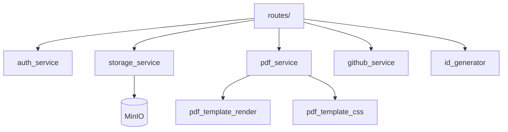

# Paquete `services/`

Lógica de negocio e integraciones externas. Las rutas no hablan con MinIO ni con GitHub directamente: pasan por estos módulos.

## Arquitectura

---

## Subpaquetes

| Paquete | README |
|---------|--------|

---

## Módulos

### Analítica del portafolio (SPEC-0010)

| Módulo | Función |
|--------|---------|
| `portal_ingest.py` | `ingest_event`: sitio, visitante (bloqueo consultivo), visita con corte de 30 min, canal, postulación, bots, dueño, contadores y eventos clave. No hace commit |
| `portal_channels.py` | `classify_channel` con reglas de `portal_channel_rules`; `extract_domain` |
| `portal_bots.py` | `score_bot` aditivo y explicable (umbral 70) |
| `portal_device.py` | `parse_device` con `ua-parser`: navegador, sistema, tipo de dispositivo, idioma |
| `portal_geo.py` | Geografía solo desde las cabeceras `cf-*` que añade la capa de entrada (sin respaldo por IP ni servicio externo) |
| `portal_ratelimit.py` | Ventana deslizante en memoria por visitante e IP |
| `portal_metrics.py` | `MetricsQuery` y todas las métricas; `rebuild_daily`, `ensure_daily_fresh`, `rebuild_visits` |

### `auth_service.py` — JWT y contraseñas

`AuthService` (SRP: solo autenticación).

| Método | Función |
|--------|---------|
| `hash_password` / `verify_password` | bcrypt, tope 72 bytes |
| `create_access_token` / `create_refresh_token` | JWT HS256 con expiración de `settings` |
| `decode_access_token` / `decode_refresh_token` | Valida tipo de token y firma |
| `extract_user_id_from_token` | `sub` del payload |

Usado por `middleware.auth` y `routes.auth_enhanced`.

### `id_generator.py` — IDs prefijados

Formato `{prefijo}-{n}` (`ach-17`, `vac-5`, `usr-1`). `TABLE_PREFIXES` es la fuente de verdad tabla → prefijo.

| Función | Uso |
|---------|-----|
| `register_id_listener(Model, prefix)` | Sequence PostgreSQL + listener `before_insert` |
| `normalize_prefixed_id` | Acepta `17` o `ach-17` y devuelve el ID canónico |
| `prefix_for_key` | Prefijo por `resource_key` |

Cada modelo de carrera llama `register_id_listener` al importarse.

### `storage_service.py` — MinIO

I/O de bucket S3-compatible. Sin acceso a BD.

`ensure_bucket`, `upload_file`, `set_visibility` (mueve entre `public/` y `private/`), `delete_file`, `get_public_url`, `get_presigned_url`, `get_object_stream`. Tráfico interno sin TLS.

### `pdf_service.py` — Generación PDF (WeasyPrint in-process)

`generate_markdown_document` y `generate_html_template_pdf` → bytes PDF. WeasyPrint corre en un `ProcessPoolExecutor` (fork en Linux) para que un crash nativo no tumbe uvicorn. Timeout 60 s. `PDFGeneratorError` si falla el render.

### `pdf_template_render.py`

Sustitución `{{variable}}` en HTML de plantillas antes de WeasyPrint.

### `pdf_template_css.py`

`resolve_template_css`: lee `PdfTemplateStyle` por `style_id` de la plantilla (activo).

### `github_service.py`

Lista repos públicos de un username (`GET api.github.com/users/{u}/repos`) para el Admin. 

### `__init__.py`

Vacío. Los consumidores importan módulos concretos (`from services import storage_service`).

---

## Servicios añadidos (operación, contacto y vacantes)

| Módulo | Rol |
|---|---|
| `contact_message_service.py` | Lógica de los mensajes de contacto del portafolio: valida, limita la tasa, guarda y avisa al dueño |
| `error_reporting.py` | Camino de **escritura** del registro de fallas (ADR-018): huella, deduplicación y decorador `capture_errors` |
| `error_report_service.py` | Camino de **lectura y gestión** del registro de fallas: lista, resumen, resolver y purgar |
| `vacancy_stage.py` | Vacantes: etapa del proceso y estado calculado (spec 007) |
