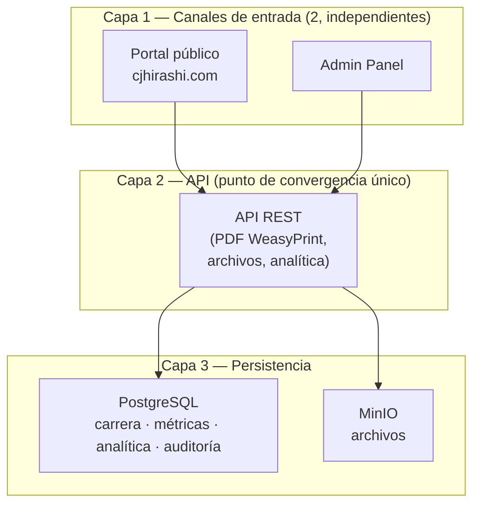

# Estrategia de solución - cjhirashi-career

**ESTRATEGIA DE SOLUCIÓN** (arc42, sección 4)

**Última actualización**: 2026-11-10

---

## Propósito

[02-ARCHITECTURE-GOALS.md](./02-ARCHITECTURE-GOALS.md) define **qué debe lograrse** y [03-STAKEHOLDERS.md](./03-STAKEHOLDERS.md) **para quién**; este documento explica **el camino elegido**: las decisiones de más alto nivel, por qué se prefirieron y cómo se organizan los contenedores. El detalle vive en [05-BUILDING-BLOCK-VIEW.md](./05-BUILDING-BLOCK-VIEW.md) y [06-RUNTIME-VIEW.md](./06-RUNTIME-VIEW.md); las decisiones formales, en [09-DECISIONS/](./09-DECISIONS/README.md).

## Decisiones de alto nivel

### 1. Dos canales independientes hacia una sola API

**Decisión**: Portal público y Admin Panel son puntos de entrada autónomos; convergen solo en la API REST y la base de datos. (Hubo un tercer canal, el MCP Server, retirado el 2026-09-04: [ADR-023](./09-DECISIONS/023-retirar-mcp-server.md); nunca implementó las herramientas de carrera y no tuvo tráfico. Los agentes externos usan hoy un token de rol `agent` sobre la API.)

**Motivación**: las audiencias (visitante anónimo, administrador autenticado, agente) tienen necesidades de acceso y disponibilidad distintas; compartir un canal acoplaría su disponibilidad.

**Consecuencia**: la API es el único punto de convergencia obligatorio y su disponibilidad es crítica para todos.

### 2. SPA en React para el Admin Panel

**Decisión**: el Admin es una SPA (React 18 + Vite + TypeScript) con CRUD dinámico, métricas y chat con agentes, no un panel renderizado en servidor.

**Motivación**: uso intensivo y frecuente por un único usuario, que alterna entre gestión manual, métricas y chat; exige transiciones fluidas.

**Consecuencia**: el Admin consume la API íntegramente por REST JSON y el estado de sesión y navegación vive en el cliente. El sidebar lo gobierna la sección activa ([ADR-024](./09-DECISIONS/024-sidebar-contextual-por-seccion.md)) y las secciones de tabla comparten plantilla ([ADR-020](./09-DECISIONS/020-admin-section-templates.md)).

### 3. PostgreSQL centralizado, también para observabilidad

**Decisión**: métricas, eventos, auditoría, registro de errores y analítica del portafolio se guardan en tablas de la misma instancia PostgreSQL que los datos de carrera, no en un almacén de series de tiempo aparte.

**Motivación**: el volumen (un administrador, un portafolio personal) no justifica un segundo motor; se gana simplicidad de despliegue, respaldo y coherencia transaccional. La analítica del portafolio (visitas, sesiones, metas, embudos, agregados diarios) usa tablas propias con sesionización y conservación prolongada; el registro de fallas, `error_reports` ([ADR-018](./09-DECISIONS/018-error-reports-registry.md)).

**Consecuencia**: el modelo crece (69 modelos, 53 migraciones Alembic); el particionado queda como trabajo futuro si el volumen lo pide.

### 4. API REST como orquestador único

**Decisión**: la API concentra el CRUD de negocio, los endpoints de gestión, las métricas, los archivos y el PDF; todo dato que necesita un canal pasa por ella.

**Motivación**: evita duplicar la lógica de acceso a datos y garantiza que las reglas de negocio (por ejemplo, qué es publicable) se apliquen igual desde cualquier origen.

**Consecuencia**: la API concentra la carga de todos los canales; es el componente con mayor prioridad de escalabilidad.

### 5. Agentes de IA externos, sin subsistema propio

**Decisión**: los agentes de IA son clientes externos de la API REST con un rol `agent` acotado a `/career/*` y a la subida de archivos ([ADR-032](./09-DECISIONS/032-agentes-externos-y-bedrock-fuera-de-operacion.md)). El harness interno de AWS Bedrock, el catálogo de agentes, Qdrant y la base de conocimiento se retiraron el 2026-11-11 ([ADR-033](./09-DECISIONS/033-retiro-del-subsistema-bedrock.md)).

**Motivación**: el harness acoplaba la API a un proveedor concreto y la indexación gastaba embeddings sin consumidor real; un agente externo ya cubre el caso con el mismo contrato.

**Consecuencia**: la API no depende de ningún proveedor de modelos; quien opera el agente decide el modelo.

## Organización en capas

| Capa | Módulos | Criterio |
|---|---|---|
| **1. Canales** | Portal público, Admin Panel | Cada uno responde a una audiencia y no depende del otro |
| **2. API** | `cjhirashi-career-api` (incluye el PDF) | Concentra las reglas de negocio; solo alcanzable desde fuera por los canales de la capa 1 (`/api/`) |
| **3. Persistencia** | PostgreSQL, MinIO | La API es la única con acceso de lectura/escritura |

## Alternativas descartadas

| Decisión adoptada | Alternativa | Por qué se descartó |
|---|---|---|
| Dos canales independientes | Un único frontend multipropósito | Acoplaría disponibilidad y autenticación de audiencias opuestas y complicaría el aislamiento de lo publicable |
| PostgreSQL también para observabilidad | Almacén de series de tiempo o eventos dedicado | El volumen no justifica un segundo motor para un solo administrador |
| MCP Server como tercer canal | Token `agent` sobre la API | El MCP no llegó a implementar herramientas de carrera y no tuvo tráfico (ADR-023) |

## Matriz de comunicación

| Origen | Destino | Protocolo | Autenticación |
|---|---|---|---|
| Visitante | Portal | HTTPS | Ninguna |
| Carlos | Admin Panel | HTTPS | Login (JWT) |
| Portal | API (`/public/*`, contacto, ingesta de analítica) | REST JSON | Ninguna; límites de tasa |
| Admin | API | REST JSON (CRUD, PDF y tareas) | JWT del administrador |
| Agente externo | API (`/career/*`, `POST /files`) | REST JSON | JWT de rol `agent` |
| API | PostgreSQL | SQL (SQLAlchemy async / asyncpg) | Credenciales de servicio, red Docker interna |
| API | MinIO | S3 | Credenciales de servicio |

Conexiones deliberadamente ausentes: Portal ↔ Admin, y cualquier acceso a PostgreSQL o MinIO que no sea desde la API.

## Trazabilidad hacia ADR

| Decisión | ADR |
|---|---|
| 1. Dos canales | ADR-014 (módulos) y ADR-023 (retiro del MCP) |
| 2. SPA del Admin | ADR-020, ADR-021, ADR-024, ADR-028 |
| 3. PostgreSQL centralizado | ADR-018 |
| 4. API orquestadora | ADR-011 (descubrimiento de vacantes, retirado por el ADR-034), ADR-015 y ADR-016 |
| 5. Agentes externos | ADR-023, ADR-032, ADR-033 |
| 6. Harness fuera de la API | ADR-029 |

---

**Relacionado**: [01-INTRODUCTION.md](./01-INTRODUCTION.md) · [02-ARCHITECTURE-GOALS.md](./02-ARCHITECTURE-GOALS.md) · [03-STAKEHOLDERS.md](./03-STAKEHOLDERS.md) · [CLAUDE.md](../CLAUDE.md)
**Contacto**: cjhirashi@gmail.com
