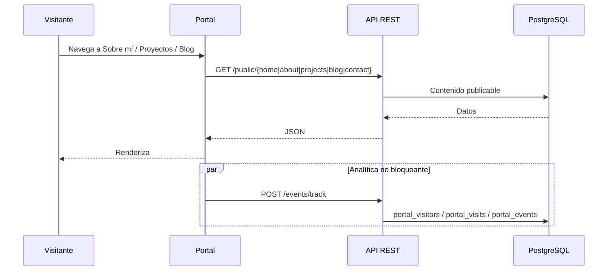
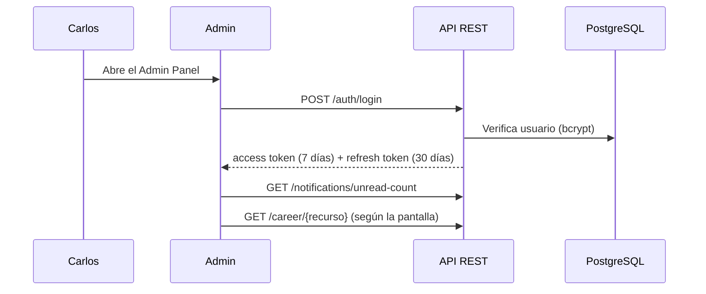
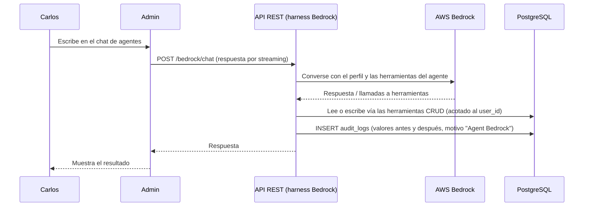
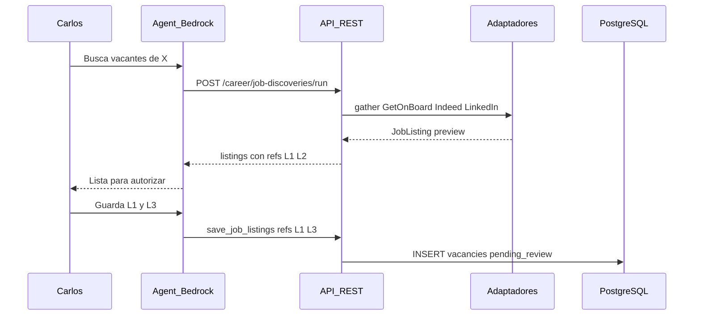
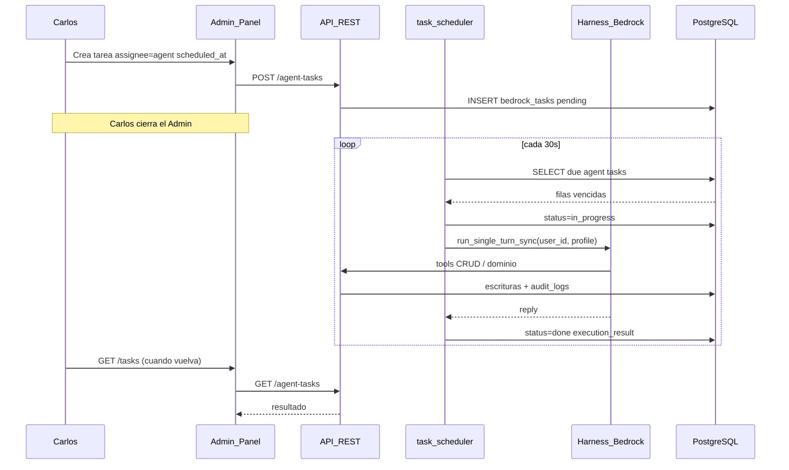
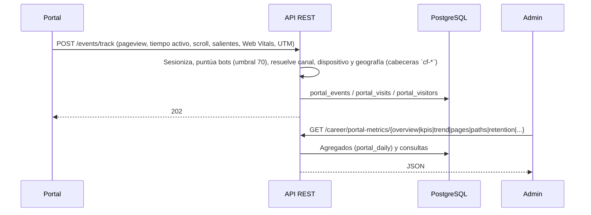

# Vista de tiempo de ejecución - cjhirashi-career

> **Estado (2026-11-10, [ADR-032](09-DECISIONS/032-agentes-externos-y-bedrock-fuera-de-operacion.md)):** el subsistema de agentes con AWS Bedrock está **fuera de operación**. Los agentes de IA son externos y entran por la API con el rol `agent`. Este documento se conserva como referencia del diseño y no describe el comportamiento operativo actual.

**VISTA DE TIEMPO DE EJECUCIÓN** (arc42, sección 6)

**Última actualización**: 2026-11-05
**Resumen**: 7 escenarios de flujo (portal público, sesión del Admin, edición manual, asistencia de Bedrock, descubrimiento de vacantes, tarea programada, plan con subtareas) y el flujo de analítica del portafolio.

> Las rutas se muestran como las ve la API. Desde el navegador llevan el prefijo `/api/` (la API las recibe sin él): `GET /api/public/home` llega a la API como `GET /public/home`.

---

## Escenario 1 — Visitante consulta el portal público

Solo lectura y sin autenticación; en paralelo, el rastreador del portal envía eventos de analítica.



**Pasos:**
1. El visitante navega a una sección pública sin cuenta.
2. El portal pide el contenido a `/public/*`; la API devuelve solo lo publicable.
3. El rastreador del portal (respeta DNT/GPC) envía eventos a `POST /events/track` sin bloquear el render; la API sesioniza, clasifica bots, resuelve el origen y la geografía y guarda el evento. `POST /events/forget` borra los datos del visitante (`/privacy`).
4. El formulario de contacto envía `POST /public/contact-message` (límite de 3 por hora por IP y por correo); el mensaje aparece en el Admin con aviso en la campana.

## Escenario 2 — Carlos abre el Admin Panel



**Pasos:**
1. Login: la API valida las credenciales y emite un JWT de acceso (HS256) y uno de refresco; el Admin los guarda en el cliente y los envía como `Authorization: Bearer`.
2. Cada pantalla pide sus datos por REST con React Query; con el token vencido, el interceptor usa `/auth/refresh`.
3. El cambio de contraseña se hace en `/change-password` (`POST /auth/change-password`).

## Escenario 3 — Carlos edita un registro de carrera

```mermaid
sequenceDiagram
    participant C as Carlos
    participant A as Admin
    participant API as API REST
    participant DB as PostgreSQL

    C->>A: Edita una competencia y guarda
    A->>API: PUT /career/competencies/{id} (Bearer)
    API->>API: Valida con Pydantic; aísla por user_id
    API->>DB: UPDATE
    API-->>A: Recurso actualizado
```

**Pasos:**
1. El Admin envía el cambio al CRUD genérico `/career/{recurso}` (IDs prefijados, p. ej. `comp-12`).
2. La API valida el esquema y limita todo al `user_id` del token.
3. La escritura no dispara ningún indexado: Qdrant y la base de conocimiento se retiraron el 2026-11-11.
4. Las ediciones manuales no generan `audit_logs`: ese registro es del agente (Escenario 4).

## Escenario 4 — Carlos usa Agent Bedrock



**Pasos:**
1. El Admin llama a `POST /bedrock/chat` con la sesión autenticada; el bucle del agente corre dentro de la API (hasta que `cjhirashi-career-ai` lo reemplace, ADR-029).
2. El agente (L1 orquestador, L2 por área, L3 por tarea: ADR-012) usa herramientas con el alcance del usuario; puede consultar la memoria del agente.
3. **Toda escritura del agente** queda en `audit_logs` con el estado completo antes y después, para poder recuperar un borrado erróneo; si el registro falla, la herramienta falla en lugar de escribir sin rastro.
4. El uso y el costo de cada ronda se guardan en `bedrock_usage_logs` y `bedrock_usage_round_logs`, con un presupuesto diario configurable.

## Escenario 5 — Descubrimiento de vacantes

Carlos o Agent Bedrock buscan vacantes. `POST /career/job-discoveries/run` no escribe `vacancies`; asigna refs `L1, L2…`. Indeed se resuelve vía Adzuna; LinkedIn solo devuelve URLs oficiales de búsqueda. El agente presenta el preview y **espera autorización**. Solo entonces `save_job_listings(refs=…)` (o `POST /save` con las marcadas en Admin) inserta `vacancies` con `evaluation=pending_review` para seguimiento. Ver [ADR-011](./09-DECISIONS/011-job-discovery-adapters.md).



## Escenario 6 — Tarea programada de un agente

Carlos crea una tarea en `/tasks`, la asigna a un agente del catálogo y pone `scheduled_at`. El Admin puede cerrarse. Un loop asyncio en la API (`task_scheduler`, mismo patrón que LinkedIn) reclama la fila y corre el harness Bedrock con el `user_id` dueño — sin JWT ni SPA. Ver [ADR-015](./09-DECISIONS/015-scheduled-agent-tasks.md).



**Pasos:**
1. Carlos asigna la tarea a un agente y una hora (Ciudad de México en la UI; UTC en PostgreSQL).
2. El scheduler de la API, no el navegador, espera `scheduled_at`.
3. Al vencer, invoca el mismo harness que el chat: L1/L2 con historial `scheduled-task-{id}`; L3 sin historial de usuario.
4. Si Bedrock o el presupuesto fallan, la tarea queda `failed` con `error_message`. "Ejecutar ahora" (`POST /agent-tasks/{id}/run`) usa el mismo runner.

## Escenario 7 — Plan con subtareas y turno

Carlos crea un padre (responsable general) y subtareas con distintos responsables. Las bloqueantes se ejecutan en `sort_order`; al completar una, el scheduler pasa el turno: agente con `execute_on_turn` corre el harness; usuario recibe un aviso en `user_notifications`. Ver [ADR-016](./09-DECISIONS/016-task-subtasks-orchestration.md).

```mermaid
sequenceDiagram
    participant Carlos
    participant Admin as Admin_Panel
    participant API as API_REST
    participant Sched as task_scheduler
    participant Bedrock as Harness_Bedrock
    participant DB as PostgreSQL

    Carlos->>Admin: Padre + subtareas (blocking / on_turn)
    Admin->>API: POST /agent-tasks (subtasks)
    API->>DB: INSERT padre e hijas
    Sched->>DB: primera subtarea desbloqueada
    alt assignee=agent execute_on_turn
        Sched->>Bedrock: run_single_turn_sync
        Bedrock-->>Sched: reply
        Sched->>DB: hija done; resume padre
    else assignee=user
        Sched->>DB: INSERT user_notifications
        Admin->>API: GET /notifications
        API-->>Carlos: Campana /tasks?task=id
        Carlos->>Admin: Marca status=done en Vista
        Admin->>API: PUT /agent-tasks/id
    end
    Sched->>DB: desbloquea la siguiente hija
```

**Pasos:**
1. El padre no se ejecuta como agente mientras tenga hijas: orquesta.
2. Una hija está bloqueada si una hermana anterior `is_blocking` no está `done`/`cancelled`.
3. Agente: `scheduled_at` **o** `execute_on_turn` al quedar libre.
4. Usuario: notificación `task_turn`; en Vista solo se edita el estado.

## Analítica del portafolio: de la visita al tablero



- **Ingesta**: pública, con límites de tasa y sin bloquear al visitante.
- **Consulta**: el Admin (tablero `/metrics`) y los agentes con token consultan `/career/portal-metrics/*` por REST; `GET .../realtime` sirve la vista casi en vivo (el Admin la consulta periódicamente; no hay canal WebSocket ni SSE de métricas). `POST .../rebuild` recalcula los agregados diarios.
- **Metas, embudos y anotaciones** (`/career/portal-goals`, `portal-funnels`, `portal-annotations`) se configuran en `/metrics/settings`.
- **Privacidad**: el id del visitante es seudónimo y `POST /events/forget` borra sus datos.

La actividad de los agentes se mide aparte: `bedrock_usage_logs` (costos), `audit_logs` (escrituras) y la pantalla de métricas del agente.

## Comparación de escenarios

| Escenario | Canal | Escribe en PostgreSQL | Auditoría | Métrica |
|---|---|---|---|---|
| 1 — Portal (lectura) | Portal | Solo analítica y mensajes de contacto | No | `portal_*` |
| 2 — Apertura de sesión | Admin | `last_login`, tokens | No | No |
| 3 — Edición manual | Admin | Sí | No | No |
| 4 — Asistencia de Bedrock | Admin (API) | Sí, si el agente escribe | Sí (`audit_logs`) | Uso y costo |
| 5 — Descubrimiento de vacantes | Admin / agente | Sí, al autorizar el guardado | Sí si lo guarda el agente | No |
| 6 — Tarea programada | Sin interfaz (scheduler de la API) | Sí, si el agente escribe | Sí | Uso y costo |
| 7 — Plan con subtareas | Admin / scheduler | Sí | Sí si el agente escribe | Uso y costo |

---

**Relacionado**: [01-INTRODUCTION.md](./01-INTRODUCTION.md) · [05-BUILDING-BLOCK-VIEW.md](./05-BUILDING-BLOCK-VIEW.md) · [07-DEPLOYMENT-VIEW.md](./07-DEPLOYMENT-VIEW.md) · [08-CROSSCUTTING-CONCEPTS.md](./08-CROSSCUTTING-CONCEPTS.md)
**Contacto**: cjhirashi@gmail.com
