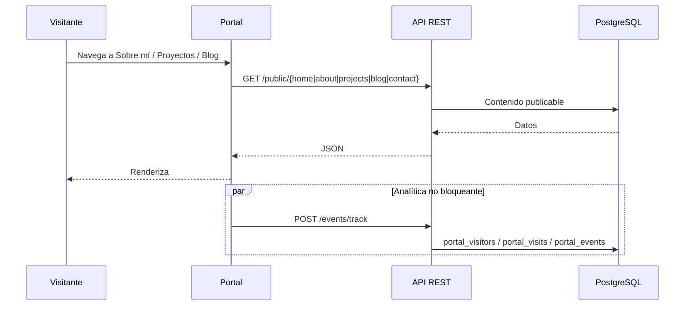
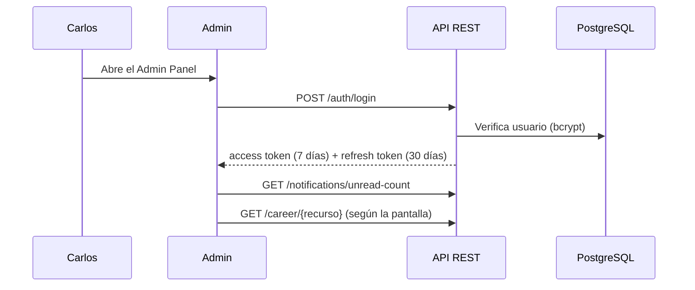
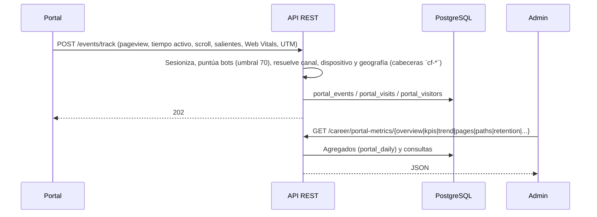

# Vista de tiempo de ejecución - cjhirashi-career

**VISTA DE TIEMPO DE EJECUCIÓN** (arc42, sección 6)

**Última actualización**: 2026-11-05
**Resumen**: 7 escenarios de flujo (portal público, sesión del Admin, edición manual, tareas) y el flujo de analítica del portafolio.

> Las rutas se muestran como las ve la API. Desde el navegador llevan el prefijo `/api/` (la API las recibe sin él): `GET /api/public/home` llega a la API como `GET /public/home`.

---

## Escenario 1 — Visitante consulta el portal público

Solo lectura y sin autenticación; en paralelo, el rastreador del portal envía eventos de analítica.



**Pasos:**
1. El visitante navega a una sección pública sin cuenta.
2. El portal pide el contenido a `/public/*`; la API devuelve solo lo publicable.
3. El rastreador del portal (respeta DNT/GPC) envía eventos a `POST /events/track` sin bloquear el render; la API sesioniza, clasifica bots, resuelve el origen y la geografía y guarda el evento. `POST /events/forget` borra los datos del visitante (`/privacy`).
4. El formulario de contacto envía `POST /public/contact-message` (límite de 3 por hora por IP y por correo); el mensaje aparece en el Admin con aviso en la campana.

## Escenario 2 — Carlos abre el Admin Panel



**Pasos:**
1. Login: la API valida las credenciales y emite un JWT de acceso (HS256) y uno de refresco; el Admin los guarda en el cliente y los envía como `Authorization: Bearer`.
2. Cada pantalla pide sus datos por REST con React Query; con el token vencido, el interceptor usa `/auth/refresh`.
3. El cambio de contraseña se hace en `/change-password` (`POST /auth/change-password`).

## Escenario 3 — Carlos edita un registro de carrera

```mermaid
sequenceDiagram
    participant C as Carlos
    participant A as Admin
    participant API as API REST
    participant DB as PostgreSQL

    C->>A: Edita una competencia y guarda
    A->>API: PUT /career/competencies/{id} (Bearer)
    API->>API: Valida con Pydantic; aísla por user_id
    API->>DB: UPDATE
    API-->>A: Recurso actualizado
```

**Pasos:**
1. El Admin envía el cambio al CRUD genérico `/career/{recurso}` (IDs prefijados, p. ej. `comp-12`).
2. La API valida el esquema y limita todo al `user_id` del token.
3. La escritura no dispara ningún indexado.
4. Las ediciones manuales no generan `audit_logs`: `audit_logs` conserva el historial de escrituras de agentes anteriores al 2026-11-11 y ya no recibe filas.

## Analítica del portafolio: de la visita al tablero



- **Ingesta**: pública, con límites de tasa y sin bloquear al visitante.
- **Consulta**: el Admin (tablero `/metrics`) y los agentes con token consultan `/career/portal-metrics/*` por REST; `GET .../realtime` sirve la vista casi en vivo (el Admin la consulta periódicamente; no hay canal WebSocket ni SSE de métricas). `POST .../rebuild` recalcula los agregados diarios.
- **Metas, embudos y anotaciones** (`/career/portal-goals`, `portal-funnels`, `portal-annotations`) se configuran en `/metrics/settings`.
- **Privacidad**: el id del visitante es seudónimo y `POST /events/forget` borra sus datos.

## Comparación de escenarios

| Escenario | Canal | Escribe en PostgreSQL | Auditoría | Métrica |
|---|---|---|---|---|
| 1 — Portal (lectura) | Portal | Solo analítica y mensajes de contacto | No | `portal_*` |
| 2 — Apertura de sesión | Admin | `last_login`, tokens | No | No |
| 3 — Edición manual | Admin | Sí | No | No |

---

**Relacionado**: [01-INTRODUCTION.md](./01-INTRODUCTION.md) · [05-BUILDING-BLOCK-VIEW.md](./05-BUILDING-BLOCK-VIEW.md) · [07-DEPLOYMENT-VIEW.md](./07-DEPLOYMENT-VIEW.md) · [08-CROSSCUTTING-CONCEPTS.md](./08-CROSSCUTTING-CONCEPTS.md)
**Contacto**: cjhirashi@gmail.com
