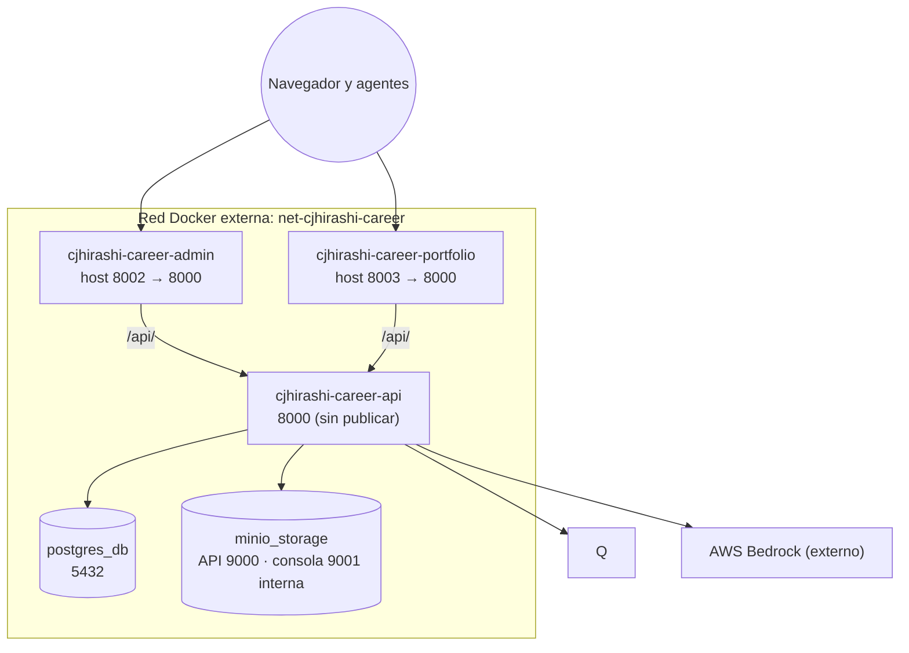

# Vista de despliegue - cjhirashi-career

**VISTA DE DESPLIEGUE** (arc42, sección 7)

**Última actualización**: 2026-11-05
**Resumen**: 5 contenedores definidos en `docker-compose.yml` (3 de aplicación + PostgreSQL y MinIO) en la red externa `net-cjhirashi-career`; solo 2 puertos publicados al host (8002 y 8003). La fuente de verdad es el propio `docker-compose.yml`.

---

## Diagrama de despliegue



## Contenedores y puertos

| Servicio (compose) | Contenedor | Imagen | Puerto | Acceso |
|---|---|---|---|---|
| `admin` | `cjhirashi-career-admin` | build local (Node 20, SPA servida) | 8002 → 8000 | Publicado al host |
| `portfolio` | `cjhirashi-career-portfolio` | build local | 8003 → 8000 | Publicado al host |
| `api` | `cjhirashi-career-api` | build local (`python:3.11-slim`) | 8000 | Interna; el portal y el Admin la llaman por `/api/` y ella recibe las rutas sin el prefijo |
| `postgres` | `postgres_db` | `postgres:15-alpine` | 5432 | Interna |
| `minio` | `minio_storage` | `minio/minio:latest` | 9000 (API), 9001 (consola) | Interna (API en 9000); la consola (9001) no se publica |

No hay contenedor de MCP (se retiró el 2026-09-04, ADR-023) ni de `cjhirashi-career-ai`: ese harness (spec 009) está en construcción y no se despliega todavía.

## Variables de entorno

El compose lee `.env` (nunca versionado; plantilla en `.env.example`). Detalle y políticas de secretos: [ENVIRONMENT-SECURITY.md](./ENVIRONMENT-SECURITY.md). Dentro de la red, la API alcanza MinIO por el nombre del servicio (`minio:9000`), nunca por `localhost`.

## Red Docker

`net-cjhirashi-career` es una red *bridge* **externa** y dedicada, que debe existir antes de levantar el compose (`docker network create net-cjhirashi-career`). Se declara como `external: true` en el compose.

## Volúmenes

Rutas absolutas en el disco de datos (`volumes: {}` en el compose):

| Dato | Ruta del host |
|---|---|
| PostgreSQL | `/mnt/disco1/cjhirashi-data/cjhirashi-career-volumes/postgres` |
| MinIO | `/mnt/disco1/cjhirashi-data/cjhirashi-career-volumes/minio` |

## Health checks

| Servicio | Prueba |
|---|---|
| `admin`, `portfolio` | `wget` a `http://localhost:8000/` cada 30 s |
| `api` | `GET /health` (urllib) cada 30 s, 40 s de arranque, 3 reintentos; `GET /system/readiness` para comprobaciones de preparación |
| `postgres` | `pg_isready` cada 10 s |
| `minio` | `curl` a `/minio/health/live` cada 10 s |

La API arranca solo cuando PostgreSQL y MinIO están sanos.

## Desarrollo

```bash
cp .env.example .env
docker compose up -d --build            # todo el sistema
docker compose up -d --build api        # un servicio
docker compose logs -f api
```

Pruebas y arranque local por servicio: [AGENTS.md](../AGENTS.md) (sección «Comandos por subproyecto»). Verifica siempre el arranque real (`GET /health`), no solo que el contenedor exista.

## Producción

Es el mismo `docker-compose.yml`. Despliegue: reconstruir el servicio (`docker compose up -d --build <servicio>`) y comprobar `GET /health`. Las migraciones se aplican con Alembic desde la API (`alembic upgrade head`); respaldo previo de PostgreSQL antes de cualquier migración con datos.

---

**Relacionado**: [01-INTRODUCTION.md](./01-INTRODUCTION.md) · [05-BUILDING-BLOCK-VIEW.md](./05-BUILDING-BLOCK-VIEW.md) · [ENVIRONMENT-SECURITY.md](./ENVIRONMENT-SECURITY.md)
**Contacto**: cjhirashi@gmail.com
